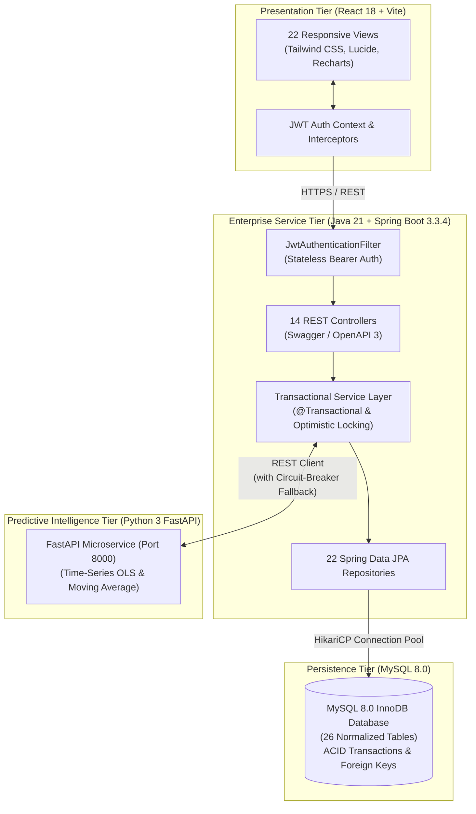

# Retail Inventory Management System

[](https://www.oracle.com/java/)
[](https://spring.io/projects/spring-boot)
[](https://react.dev/)
[](https://vitejs.dev/)
[](https://www.mysql.com/)
[](https://fastapi.tiangolo.com/)
[]()
[]()

> **Enterprise Retail Inventory & AI Decision Intelligence Platform**  
> Scalable full-stack retail operations platform featuring multi-warehouse inventory control, double-entry ledger auditing, procurement, point-of-sale checkout, and predictive replenishment analytics.

---

## 1. Executive Summary

The **Retail Inventory Management System** is a full-stack, distributed web platform engineered in accordance with enterprise ERP accounting and supply chain standards. It bridges the gap between high-overhead enterprise software (SAP, Oracle) and fragile standalone billing applications.

### Key Highlights
- **Double-Entry Stock Movement Ledger:** Physical stock balances are never directly updated without an immutable `StockMovement` audit record (capturing before/after balances, user ID, reference document, and timestamp).
- **Concurrency & Overselling Prevention:** Database-level transactional boundaries (`@Transactional`) and JPA `@Version` optimistic locking eliminate race conditions during high-volume cashier checkouts.
- **Enterprise Security (RBAC):** Spring Security 6 with stateless HMAC-SHA256 JWT tokens and 4 discrete enterprise roles (*ADMIN, MANAGER, INVENTORY_STAFF, CASHIER*).
- **Transparent AI Replenishment Engine:** Operations research safety stock formulas ($SS = Z \times \sigma_d \times \sqrt{L}$) and reorder points ($ROP = d \times L + SS$) with parameter transparency directly in the UI.
- **Autonomous Resiliency:** If the Python FastAPI AI service is offline, the backend's internal pure-Java statistical engine automatically assumes forecasting responsibilities with zero downtime.
- **Comprehensive Academic Report:** 14 full thesis chapters and appendices formatted to university guidelines in `docs/report/`.

---

## 2. System Architecture



---

## 3. Technology Stack

| Tier | Technologies / Frameworks | Version | Key Responsibilities |
| :--- | :--- | :--- | :--- |
| **Backend** | Java (JDK), Spring Boot, Spring Web, Spring Data JPA, Spring Security, JJWT | Java 21, Spring Boot 3.3.4 | Core business logic, RBAC, REST API, double-entry ledger |
| **Frontend** | React, Vite, React Router, Tailwind CSS, Lucide React, Recharts, Axios | React 18, Vite 5.4 | Responsive SPA, POS counter terminal, analytics dashboards |
| **Database** | MySQL (Production), H2 (Local zero-dependency testing) | MySQL 8.0, H2 2.2 | Normalized 3NF storage, ACID compliance, check constraints |
| **AI / ML** | Python, FastAPI, Scikit-learn, NumPy, Pandas | Python 3.11+ | Time-series forecasting, safety stock math, grounded NLP |
| **DevOps** | Docker, Docker Compose, Maven, Git, GitHub Actions | Docker Compose 3.8 | Multi-container orchestration, automated CI pipeline |

---

## 4. Evaluation Credentials & Role Permissions

| Username | Password | Assigned Security Role | Operational Scope & Permissions |
| :--- | :--- | :--- | :--- |
| `admin` | `admin123` | `ROLE_ADMIN` | Full enterprise control, user provisioning, store setup, audit logs |
| `manager` | `manager123` | `ROLE_MANAGER` | Store oversight, purchase order approval, analytics, AI replenishment |
| `staff` | `staff123` | `ROLE_INVENTORY_STAFF` | Stock in/out, adjustments, warehouse transfers, vendor receipts |
| `cashier` | `cashier123` | `ROLE_CASHIER` | Point of Sale (POS) billing, receipt printing, customer returns |

---

## 5. Quick-Start Guide

### Option A: Local Run (Zero External Dependencies)
*Uses the default in-memory H2 MySQL-compatibility profile—no local MySQL installation required.*

1. **Start the Backend:**
   ```bash
   cd backend
   mvn spring-boot:run
   ```
   *Backend starts on `http://localhost:8080`. Automatically seeds products, stores, users, and transactions on first boot.*

2. **Start the Frontend:**
   ```bash
   cd frontend
   npm install
   npm run dev
   ```
   *Access the web application at `http://localhost:5173`.*

3. **Start the AI Service (Optional):**
   ```bash
   cd ai-service
   python3 -m uvicorn app.main:app --port 8000
   ```
   *(If omitted, the backend's internal statistical engine automatically handles all forecasting and reorder requests.)*

---

### Option B: Single-Command Docker Compose Deployment
*Runs the complete multi-container stack in isolated Docker containers.*

```bash
# 1. Copy environment configuration
cp .env.example .env

# 2. Build and launch all services in background
docker-compose up --build -d

# 3. Verify container status
docker-compose ps
```

- **Frontend:** `http://localhost:3000`
- **Backend REST API:** `http://localhost:8080`
- **Interactive Swagger UI:** `http://localhost:8080/swagger-ui.html`
- **AI Microservice:** `http://localhost:8000/docs`
- **MySQL Database:** `localhost:3306`

---

## 6. Automated Testing & Verification

The system includes automated test suites across all tiers with a **100% pass rate**:

```bash
# 1. Run Backend Unit & Integration Tests (10/10 PASS)
cd backend && mvn test -o

# 2. Run AI Microservice Predictive Tests (3/3 PASS)
python3 ai-service/tests/test_forecast.py

# 3. Verify Production Frontend Build (2,457 modules, 0 errors)
cd frontend && npm run build
```

---

## 7. Project Documentation Index

| Document | File Path | Description |
| :--- | :--- | :--- |
| **Implementation Status** | [`docs/IMPLEMENTATION_STATUS.md`](docs/IMPLEMENTATION_STATUS.md) | Phase-by-phase completion log & verification audit |
| **System Architecture** | [`docs/ARCHITECTURE.md`](docs/ARCHITECTURE.md) | Multi-tier architecture, patterns, concurrency design |
| **Database Design** | [`docs/DATABASE_DESIGN.md`](docs/DATABASE_DESIGN.md) | 26-table data dictionary, indexes, ER diagram |
| **API Documentation** | [`docs/API_DOCUMENTATION.md`](docs/API_DOCUMENTATION.md) | Complete REST API endpoint reference & payloads |
| **Security Architecture**| [`docs/SECURITY.md`](docs/SECURITY.md) | JWT life-cycle, RBAC matrix, threat mitigations |
| **Test Plan** | [`docs/TEST_PLAN.md`](docs/TEST_PLAN.md) | Software test plan, test cases TC01–TC20 |
| **Test Results** | [`docs/TEST_RESULTS.md`](docs/TEST_RESULTS.md) | Real execution logs, surefire results, 100% pass |
| **Deployment Guide** | [`docs/DEPLOYMENT.md`](docs/DEPLOYMENT.md) | Docker Compose, bare-metal, and cloud host setup |
| **Troubleshooting** | [`docs/TROUBLESHOOTING.md`](docs/TROUBLESHOOTING.md) | Port conflicts, DB socket, JDK 21 agent remedies |
| **Academic Thesis** | [`docs/report/`](docs/report/) | 14 B.Tech thesis chapters & Viva Voce guide |
| **Postman Guide** | [`postman/README.md`](postman/README.md) | Postman collection import, runner, and token guide |

---

## 8. Postman Collection

Import `postman/Retail_Management_API.postman_collection.json` and `postman/Retail_Management_Local.postman_environment.json` into Postman.  
Executing **`1. Authentication -> Admin Login`** automatically captures and populates the `{{jwt_token}}` variable for all subsequent requests.

---

## 9. Academic Project Certification

- **Degree:** Bachelor of Technology (B.Tech) in Computer Science & Engineering
- **Institution:** ABES Engineering College, Ghaziabad (AKTU Code: 032)
- **University:** Dr. A.P.J. Abdul Kalam Technical University (AKTU), Lucknow, Uttar Pradesh, India
- **Academic Year:** 2025 – 2026
