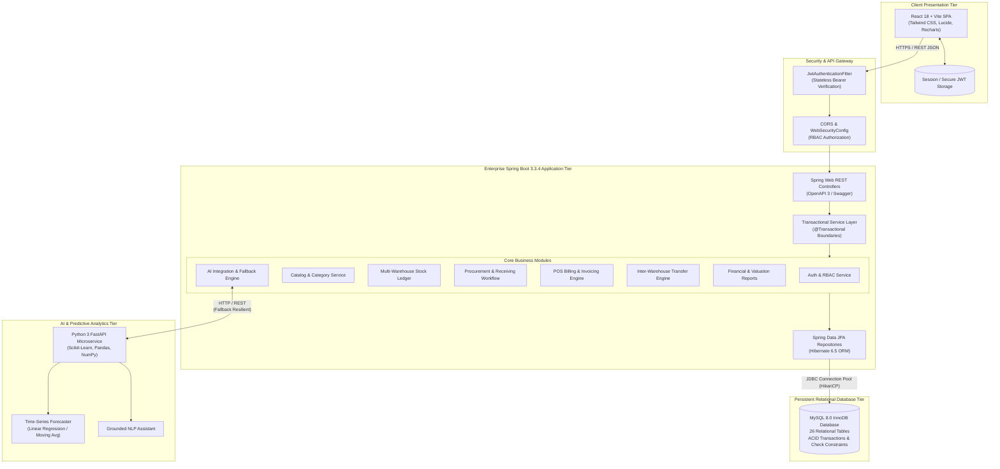
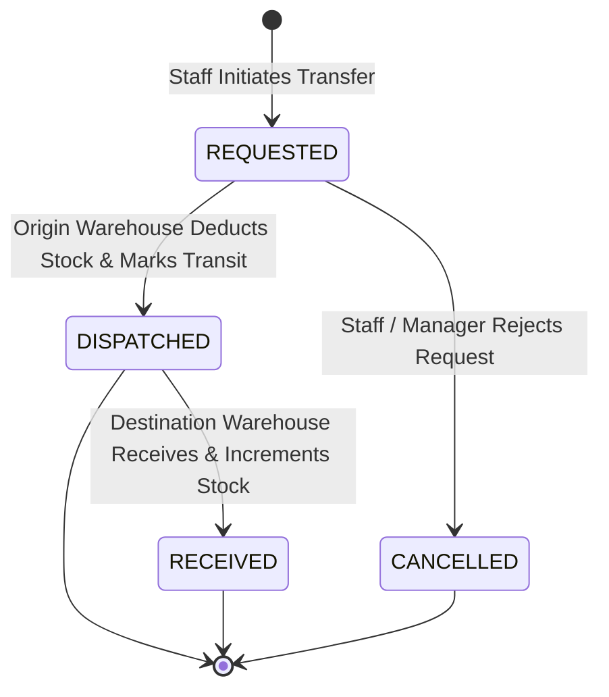

# System Architecture & Technical Design Document

**Project:** Enterprise Retail Management, Inventory Control & AI-Powered Business Intelligence System  
**Institution:** ABES Engineering College, Department of Computer Science & Engineering  
**Version:** 1.0.0 (Production / Final B.Tech CSE Thesis Submission)

---

## 1. Architectural Overview

The system is designed as an **Enterprise Multi-Tier Decoupled Architecture** with an intelligent hybrid AI microservice integration. It segregates concerns into distinct layers:
1. **Presentation Layer:** Modern single-page application (SPA) built with React 18, Vite, Tailwind CSS, and Recharts.
2. **Application & Business Logic Layer:** Enterprise Java 21 REST API built on Spring Boot 3.3.4 with Spring Security (stateless JWT), Spring Data JPA, and transactional service boundaries.
3. **Data Persistence Layer:** MySQL 8.0 relational database with strict ACID compliance, InnoDB engine, foreign key cascades, and check constraints (with H2 in-memory MySQL-compatibility for rapid zero-dependency CI testing).
4. **AI & Machine Learning Engine:** Python 3 FastAPI microservice running time-series regression and moving-average forecasting models, backed by an autonomous statistical fallback inside the Java service.



---

## 2. Core Architectural Design Patterns

### 2.1 Repository & Data Access Object (DAO) Pattern
- Spring Data JPA `JpaRepository` interfaces abstract low-level JDBC and SQL operations.
- Custom JPQL queries with index hints ensure high throughput on high-cardinality ledger tables (`StockMovement`, `SaleItem`, `Inventory`).

### 2.2 Data Transfer Object (DTO) Pattern
- Internal JPA Entities are strictly isolated from the REST API boundary.
- All requests and responses utilize validated DTOs (`@Valid`, Jakarta Bean Validation) to prevent over-posting and mass-assignment vulnerabilities.

### 2.3 Double-Entry Stock Movement Ledger Pattern
- In compliance with enterprise ERP standards (such as SAP and Oracle Retail), **stock quantities are never arbitrarily incremented or decremented without an immutable audit record**.
- Every inventory modification triggers a `StockMovement` row with `MovementType` (`PURCHASE_RECEIPT`, `SALE_DEDUCTION`, `TRANSFER_OUT`, `TRANSFER_IN`, `ADJUSTMENT_IN`, `ADJUSTMENT_OUT`, `RETURN_RESTOCK`), recording before/after balances, timestamps, reference document IDs, and user IDs.

### 2.4 Resilient Graceful Degradation (Circuit-Breaker Fallback)
- The Java backend interacts with the Python FastAPI AI service via a non-blocking HTTP client.
- If the AI microservice is offline, unreachable, or undergoing deployment, the backend **automatically triggers internal deterministic operations research algorithms** (historical moving average, standard deviation formula: $SS = Z \times \sigma_d \times \sqrt{L}$). The core application never fails or displays HTTP 500 errors to users.

### 2.5 Role-Based Access Control (RBAC) Pattern
- Four distinct enterprise roles:
  1. `ROLE_ADMIN`: Superuser authority across all stores, configurations, users, and audit logs.
  2. `ROLE_MANAGER`: Store-level operations, PO approvals, inventory transfers, and analytics.
  3. `ROLE_INVENTORY_STAFF`: Stock receipts, warehouse adjustments, and transfers.
  4. `ROLE_CASHIER`: Point-of-sale checkout, customer receipts, and authorized returns.
- Enforced declaratively via `@PreAuthorize("hasRole(...)")` at the controller and service methods.

---

## 3. Transactional Integrity & Concurrency Control

### 3.1 Double-Spending & Overselling Prevention
During simultaneous checkout operations at physical POS counters or online channels:
- Spring Boot executes sales transactions inside `@Transactional(isolation = Isolation.READ_COMMITTED)`.
- Stock deductions verify available quantity before decrementing:
  ```java
  if (inventory.getQuantity() < item.getQuantity()) {
      throw new InsufficientStockException("Insufficient stock for SKU: " + product.getSku());
  }
  ```
- Optimistic locking using JPA `@Version` on the `Inventory` entity prevents lost updates during concurrent high-frequency transactions.

### 3.2 Atomic Multi-Warehouse Stock Transfers
Inter-warehouse transfers follow a strict two-phase state machine:

1. **REQUESTED:** Source inventory availability verified and reserved.
2. **DISPATCHED:** Origin stock decremented, `StockMovement` logged as `TRANSFER_OUT`.
3. **RECEIVED:** Destination stock incremented, `StockMovement` logged as `TRANSFER_IN`.
4. Cancellation safely releases reservations without balance corruption.

---

## 4. Technology Stack Specifications

| Layer | Component | Version | Role in Architecture |
| :--- | :--- | :--- | :--- |
| **Language** | Java (Oracle / OpenJDK) | 21.0.x | Core platform runtime with Virtual Threads capability |
| **Backend Framework** | Spring Boot | 3.3.4 | Dependency injection, MVC, Security, JPA container |
| **Security** | Spring Security + JJWT | 0.12.6 | Stateless JWT auth, BCrypt hashing, role filters |
| **Persistence** | Spring Data JPA / Hibernate | 6.5.x | Object-relational mapping, transaction management |
| **Database** | MySQL | 8.0.x | Production ACID persistent storage (InnoDB) |
| **Database (Test)** | H2 Database | 2.2.x | Zero-dependency fast integration testing (MySQL mode) |
| **Frontend Framework**| React | 18.3.1 | Component-based reactive UI |
| **Build Tool (Web)** | Vite | 5.4.x | Fast HMR development server & production bundler |
| **UI Components** | Custom Tailwind CSS | 3.4.x | Fully responsive enterprise design system |
| **Icons & Charts** | Lucide React + Recharts | 0.441+ | Visualizations, KPI cards, and trend analytics |
| **AI Microservice** | Python + FastAPI | 3.11+ | Machine learning demand forecasting and NLP chat |
| **Containers** | Docker & Docker Compose | 3.8 | Orchestration of frontend, backend, AI, and MySQL |
