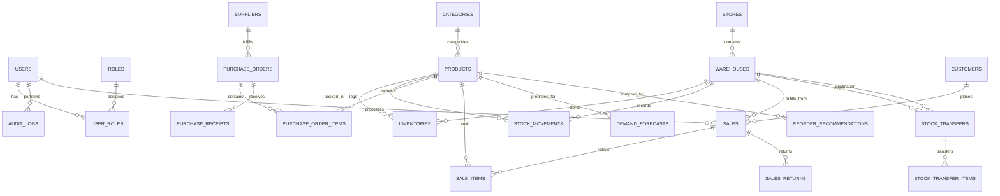

# Database Design & Entity Relationship Specification

**Project:** Enterprise Retail Management, Inventory Control & AI-Powered Business Intelligence System  
**Database Engine:** MySQL 8.0.x (InnoDB Engine, utf8mb4 charset)  
**Schema Compliance:** Third Normal Form (3NF), Referential Integrity Constraints, Immutable Audit Trails

---

## 1. Entity Relationship Diagram (ERD)



---

## 2. Relational Schema Data Dictionary

The enterprise relational schema comprises **26 normalized tables** with strict foreign key constraints and decimal precision.

### 2.1 Identity, Authentication & RBAC

#### `roles`
Stores application security roles.
| Column | Type | Constraints | Description |
| :--- | :--- | :--- | :--- |
| `id` | BIGINT | PRIMARY KEY, AUTO_INCREMENT | Unique role identifier |
| `name` | VARCHAR(50) | UNIQUE, NOT NULL | Role name (`ROLE_ADMIN`, `ROLE_MANAGER`, etc.) |
| `description`| VARCHAR(255)| NULL | Human-readable role description |

#### `users`
Stores user profile credentials and account status.
| Column | Type | Constraints | Description |
| :--- | :--- | :--- | :--- |
| `id` | BIGINT | PRIMARY KEY, AUTO_INCREMENT | Unique user identifier |
| `username` | VARCHAR(50) | UNIQUE, NOT NULL | Login username |
| `email` | VARCHAR(100)| UNIQUE, NOT NULL | Verified corporate email |
| `password` | VARCHAR(255)| NOT NULL | BCrypt hashed password |
| `full_name` | VARCHAR(100)| NOT NULL | Employee full legal name |
| `active` | BOOLEAN | NOT NULL, DEFAULT TRUE | Account active/deactivated status |
| `store_id` | BIGINT | FOREIGN KEY (`stores.id`)| Primary store assignment (optional) |
| `created_at`| TIMESTAMP | DEFAULT CURRENT_TIMESTAMP | Record creation timestamp |
| `updated_at`| TIMESTAMP | DEFAULT CURRENT_TIMESTAMP | Last modification timestamp |

#### `user_roles`
Junction table implementing many-to-many role mappings.
| Column | Type | Constraints | Description |
| :--- | :--- | :--- | :--- |
| `user_id` | BIGINT | PRIMARY KEY, FK (`users.id`) | Foreign key to user |
| `role_id` | BIGINT | PRIMARY KEY, FK (`roles.id`) | Foreign key to role |

#### `audit_logs`
Immutable compliance ledger recording all security and high-impact mutations.
| Column | Type | Constraints | Description |
| :--- | :--- | :--- | :--- |
| `id` | BIGINT | PRIMARY KEY, AUTO_INCREMENT | Unique audit log ID |
| `user_id` | BIGINT | NULL, FK (`users.id`) | Actor user ID |
| `username` | VARCHAR(50) | NOT NULL | Captured actor username |
| `action` | VARCHAR(100)| NOT NULL | Operation performed (LOGIN, SALE_CREATE, etc.)|
| `entity_name`| VARCHAR(50)| NOT NULL | Target entity type (`Product`, `Sale`, `User`)|
| `entity_id`| VARCHAR(50) | NULL | Target primary key |
| `details` | TEXT | NULL | JSON or text representation of changes |
| `ip_address`| VARCHAR(45) | NULL | IPv4 / IPv6 client origin |
| `created_at`| TIMESTAMP | DEFAULT CURRENT_TIMESTAMP | Audit timestamp |

---

### 2.2 Organization & Locations

#### `stores`
Retail outlet branches.
| Column | Type | Constraints | Description |
| :--- | :--- | :--- | :--- |
| `id` | BIGINT | PRIMARY KEY, AUTO_INCREMENT | Store identifier |
| `code` | VARCHAR(50) | UNIQUE, NOT NULL | Store code (e.g., `STR-001`) |
| `name` | VARCHAR(100)| NOT NULL | Store display name |
| `address`, `city`, `phone` | VARCHAR | NOT NULL | Contact details |
| `active` | BOOLEAN | NOT NULL, DEFAULT TRUE | Operating status |

#### `warehouses`
Physical storage facilities and stock holding locations.
| Column | Type | Constraints | Description |
| :--- | :--- | :--- | :--- |
| `id` | BIGINT | PRIMARY KEY, AUTO_INCREMENT | Warehouse identifier |
| `code` | VARCHAR(50) | UNIQUE, NOT NULL | Facility code (e.g., `WH-MAIN`) |
| `name` | VARCHAR(100)| NOT NULL | Facility name |
| `store_id` | BIGINT | NULL, FK (`stores.id`) | Linked retail store (if store depot) |
| `capacity` | INT | NOT NULL, DEFAULT 10000 | Maximum unit holding capacity |
| `active` | BOOLEAN | NOT NULL, DEFAULT TRUE | Operational status |

---

### 2.3 Catalog & Inventory Management

#### `categories`
Hierarchical product categorization.
| Column | Type | Constraints | Description |
| :--- | :--- | :--- | :--- |
| `id` | BIGINT | PRIMARY KEY, AUTO_INCREMENT | Category identifier |
| `name` | VARCHAR(100)| UNIQUE, NOT NULL | Category name |
| `code` | VARCHAR(50) | UNIQUE, NOT NULL | Category code |
| `parent_id`| BIGINT | NULL, FK (`categories.id`)| Self-referencing parent hierarchy |
| `active` | BOOLEAN | DEFAULT TRUE | Display status |

#### `products`
Master catalog items.
| Column | Type | Constraints | Description |
| :--- | :--- | :--- | :--- |
| `id` | BIGINT | PRIMARY KEY, AUTO_INCREMENT | Master product ID |
| `sku` | VARCHAR(50) | UNIQUE, NOT NULL | Stock Keeping Unit |
| `name` | VARCHAR(150)| NOT NULL | Product trade title |
| `barcode` | VARCHAR(100)| UNIQUE, NULL | UPC/EAN Barcode representation |
| `category_id`| BIGINT | FK (`categories.id`) | Product category |
| `brand` | VARCHAR(100)| NULL | Brand / Manufacturer |
| `unit` | VARCHAR(20) | NOT NULL, DEFAULT 'PIECE' | Measurement unit (PIECE, KG, LITER) |
| `cost_price`| DECIMAL(12,2)| NOT NULL, CHECK (>= 0) | Procurement cost |
| `selling_price`| DECIMAL(12,2)| NOT NULL, CHECK (>= 0)| Standard retail shelf price |
| `tax_rate` | DECIMAL(5,2) | NOT NULL, DEFAULT 0.00 | Applicable VAT / GST percentage |
| `reorder_level`| INT | NOT NULL, DEFAULT 10 | Minimum safety threshold for alerts |
| `target_stock` | INT | NOT NULL, DEFAULT 50 | Target replenishment holding level |
| `lead_time_days`| INT | NOT NULL, DEFAULT 3 | Supplier delivery turnaround in days |
| `active` | BOOLEAN | NOT NULL, DEFAULT TRUE | Soft-delete / active status |

#### `inventories`
Composite ledger holding live stock balances per product per warehouse.
| Column | Type | Constraints | Description |
| :--- | :--- | :--- | :--- |
| `id` | BIGINT | PRIMARY KEY, AUTO_INCREMENT | Stock balance ID |
| `product_id`| BIGINT | NOT NULL, FK (`products.id`) | Target product |
| `warehouse_id`| BIGINT | NOT NULL, FK (`warehouses.id`)| Holding warehouse |
| `quantity` | INT | NOT NULL, DEFAULT 0, CHECK (>= 0) | Physical on-hand balance |
| `reserved_quantity`| INT | NOT NULL, DEFAULT 0, CHECK (>= 0) | Units reserved for pending transfers |
| `reorder_point`| INT | NOT NULL, DEFAULT 10 | Calculated ROP trigger |
| `version` | BIGINT | NOT NULL, DEFAULT 0 | Optimistic concurrency control lock |
| **Unique Constraint** | `UNIQUE(product_id, warehouse_id)` | Prevents duplicate stock rows |

#### `stock_movements`
Double-entry immutable audit ledger.
| Column | Type | Constraints | Description |
| :--- | :--- | :--- | :--- |
| `id` | BIGINT | PRIMARY KEY, AUTO_INCREMENT | Movement log ID |
| `product_id` | BIGINT | NOT NULL, FK (`products.id`) | Product moved |
| `warehouse_id` | BIGINT | NOT NULL, FK (`warehouses.id`)| Warehouse context |
| `movement_type` | VARCHAR(50)| NOT NULL | `PURCHASE_RECEIPT`, `SALE_DEDUCTION`, etc. |
| `quantity` | INT | NOT NULL | Positive integer indicating quantity changed |
| `unit_cost` | DECIMAL(12,2)| NULL | Unit cost applied during movement |
| `balance_before`| INT | NOT NULL | On-hand quantity prior to transaction |
| `balance_after` | INT | NOT NULL | On-hand quantity post transaction |
| `reference_type`| VARCHAR(50)| NULL | `SALE`, `PURCHASE_ORDER`, `TRANSFER` |
| `reference_id` | BIGINT | NULL | Foreign key reference to document ID |
| `reason` | VARCHAR(255)| NULL | Justification / note |
| `user_id` | BIGINT | NULL, FK (`users.id`) | Authorized operator |
| `created_at` | TIMESTAMP | DEFAULT CURRENT_TIMESTAMP | Execution timestamp |

---

### 2.4 Procurement, Sales & Transfers

- **`suppliers`**: Vendors with tax ID, lead time, and payment terms.
- **`purchase_orders`**: Procurement contracts with statuses (`DRAFT`, `SUBMITTED`, `APPROVED`, `PARTIALLY_RECEIVED`, `RECEIVED`, `CANCELLED`).
- **`purchase_order_items`**: Purchase order line items with agreed `unit_cost` and `quantity_received`.
- **`sales`**: Point-of-sale customer receipts with `invoice_number`, `payment_method`, `total_amount`, and `discount_amount`.
- **`sale_items`**: Line items with captured historical unit price, tax, discount, and profit margin.
- **`sales_returns`**: Return credit notes with reason and restock flag.
- **`stock_transfers`**: Inter-warehouse transfer manifests with statuses (`REQUESTED`, `DISPATCHED`, `RECEIVED`, `CANCELLED`).
- **`demand_forecasts`**: Time-series model outputs storing projected daily demand and confidence intervals.
- **`reorder_recommendations`**: Operations research replenishment decisions with mathematical formula transparency.

---

## 3. Database Indexes for Query Optimization

```sql
-- High-frequency barcode and SKU lookups
CREATE INDEX idx_products_sku ON products(sku);
CREATE INDEX idx_products_barcode ON products(barcode);

-- Inventory lookups and multi-warehouse joins
CREATE INDEX idx_inventory_prod_wh ON inventories(product_id, warehouse_id);

-- Sales chronological queries and invoice lookups
CREATE INDEX idx_sales_invoice ON sales(invoice_number);
CREATE INDEX idx_sales_created_at ON sales(created_at);
CREATE INDEX idx_sale_items_product ON sale_items(product_id);

-- Stock movements audit queries
CREATE INDEX idx_movements_prod_date ON stock_movements(product_id, created_at);
CREATE INDEX idx_movements_wh_date ON stock_movements(warehouse_id, created_at);

-- Security and audit trail
CREATE INDEX idx_audit_user_action ON audit_logs(user_id, action);
```
