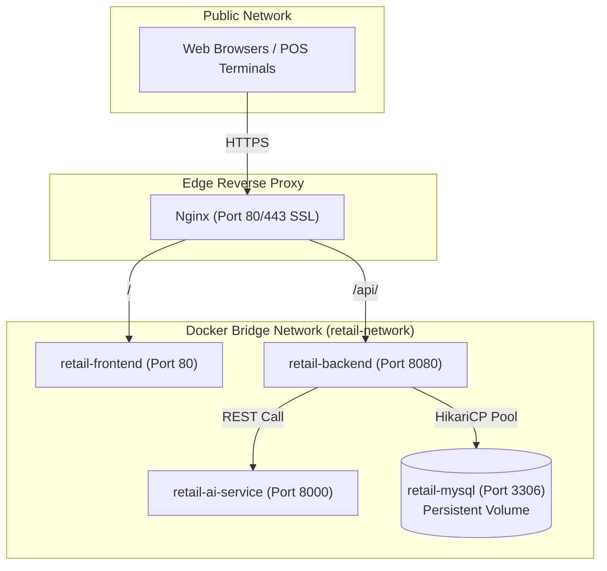

# Enterprise Deployment & Operations Guide

**Project:** Enterprise Retail Management, Inventory Control & AI-Powered Business Intelligence System  
**Version:** 1.0.0

---

## 1. Deployment Topology Options

The system can be deployed using three distinct operational strategies:
1. **Local Developer / Evaluation Mode:** Zero-dependency local setup using default H2 in-memory MySQL mode.
2. **Containerized Production Orchestration:** Full multi-container stack orchestrated via `docker-compose.yml` (MySQL 8, Spring Boot 3.3.4, React SPA on Nginx, Python 3 FastAPI).
3. **Cloud VM / Linux Enterprise Host (Systemd + Nginx):** Production deployment on AWS EC2, DigitalOcean Droplet, or Ubuntu Server.



---

## 2. Quick-Start Evaluation (Zero External Dependencies)

To evaluate the system immediately without installing MySQL:

### Step 1: Start Backend (Spring Boot with H2 MySQL-Mode)
```bash
cd backend
mvn spring-boot:run
```
*The backend initializes on `http://localhost:8080`, seeds demo products, stores, users, and transactions automatically.*

### Step 2: Start AI Prediction Service (Optional)
```bash
cd ai-service
python3 -m uvicorn app.main:app --port 8000 --reload
```
*(If omitted, the backend's internal statistical engine automatically services all forecasting and reorder requests.)*

### Step 3: Start React Frontend
```bash
cd frontend
npm install
npm run dev
```
*Access the enterprise dashboard at `http://localhost:5173`.*

---

## 3. Containerized Orchestration with Docker Compose

For a complete isolated production-like deployment:

### Step 1: Configure Environment
Copy and review the environment file:
```bash
cp .env.example .env
```

### Step 2: Build and Run Containers
```bash
docker-compose up --build -d
```

### Step 3: Verify Container Health
```bash
docker-compose ps
```
Expected output:
- `retail-mysql`: Up (healthy) - Port `3306`
- `retail-backend`: Up - Port `8080`
- `retail-ai-service`: Up - Port `8000`
- `retail-frontend`: Up - Port `3000`

### Step 4: Stop Containers
```bash
docker-compose down
# To preserve database data, omit the -v flag.
```

---

## 4. Production Host Configuration (Ubuntu 22.04 LTS / Systemd)

### 4.1 Systemd Backend Service (`/etc/systemd/system/retail-backend.service`)
```ini
[Unit]
Description=Retail Management Spring Boot Backend
After=syslog.target network.target mysql.service

[Service]
User=retailapp
WorkingDirectory=/opt/retail-management/backend
ExecStart=/usr/bin/java -Xms512m -Xmx2048m -Dspring.profiles.active=mysql -jar app.jar
SuccessExitStatus=143
Restart=always
RestartSec=10

[Install]
WantedBy=multi-user.target
```

### 4.2 Systemd AI Microservice (`/etc/systemd/system/retail-ai.service`)
```ini
[Unit]
Description=Retail AI Demand Forecasting Service
After=network.target

[Service]
User=retailapp
WorkingDirectory=/opt/retail-management/ai-service
ExecStart=/opt/retail-management/ai-service/venv/bin/uvicorn app.main:app --host 127.0.0.1 --port 8000
Restart=always
RestartSec=5

[Install]
WantedBy=multi-user.target
```

---

## 5. Security & SSL Hardening Checklist

- [x] Change default database passwords (`MYSQL_ROOT_PASSWORD`, `MYSQL_PASSWORD`) in `.env`.
- [x] Generate a unique 256-bit cryptographically secure string for `JWT_SECRET`.
- [x] Enable HTTPS via Let's Encrypt Certbot (`certbot --nginx -d retail.yourdomain.com`).
- [x] Restrict MySQL port `3306` to localhost / internal Docker bridge only.
- [x] Ensure non-root execution inside Docker containers (`adduser -S appuser`).
