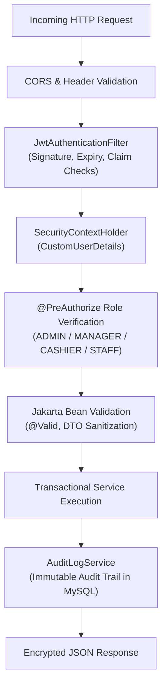

# Security Architecture & Threat Mitigation Specification

**Project:** Enterprise Retail Management, Inventory Control & AI-Powered Business Intelligence System  
**Framework:** Spring Security 6.x / Spring Boot 3.3.4  
**Authentication Standard:** Stateless JSON Web Token (RFC 7519) + BCrypt (RFC 2898)

---

## 1. Security Overview & Threat Model

Enterprise retail management systems handle financial transactions, inventory valuations, employee access, and vendor data. The system enforces defense-in-depth across the presentation, application, and persistence tiers to mitigate the OWASP Top 10 vulnerabilities.

---

## 2. Authentication & JWT Token Management

### 2.1 Password Security
- User passwords are **never stored in plaintext**.
- Passwords are encrypted using **BCrypt with a workload factor of 10**. BCrypt incorporates an automated salt per record, protecting against rainbow-table attacks.

### 2.2 JWT Token Architecture
- **Algorithm:** HMAC-SHA256 (`HS256`) with a 256-bit cryptographic secret.
- **Payload Claims:**
  - `sub`: Username
  - `roles`: Collection of assigned authorities (e.g., `["ROLE_ADMIN", "ROLE_MANAGER"]`)
  - `iat`: Epoch issuance timestamp
  - `exp`: Epoch expiration timestamp (configurable, default 24 hours)
- **Token Verification:**
  - Executed on every request via `JwtAuthenticationFilter` prior to reaching Spring MVC controllers.
  - Invalid, expired, or tampered signatures immediately return HTTP 401 Unauthorized with zero stack-trace leakage.

---

## 3. Role-Based Access Control (RBAC) Matrix

| Resource / Functionality | `ROLE_ADMIN` | `ROLE_MANAGER` | `ROLE_INVENTORY_STAFF` | `ROLE_CASHIER` |
| :--- | :---: | :---: | :---: | :---: |
| **User & Role Provisioning** | Full Access | No Access | No Access | No Access |
| **System Audit Logs** | View All | No Access | No Access | No Access |
| **Store & Warehouse Creation** | Full Access | View Only | View Only | View Only |
| **Product & Category CRUD** | Full Access | Full Access | View Only | View Only |
| **Multi-Warehouse Stock Adjustments** | Full Access | Full Access | Execute with Reason | No Access |
| **Purchase Order Approval** | Full Access | Full Access | No Access | No Access |
| **Goods Receipt into Inventory** | Full Access | Full Access | Full Access | No Access |
| **Inter-Warehouse Stock Transfers** | Full Access | Full Access | Execute / Dispatch | No Access |
| **Point of Sale (POS) Billing** | Full Access | Full Access | View Only | Full Access |
| **Sales Returns & Customer Refunds** | Full Access | Full Access | No Access | Process Return |
| **Financial & Valuation Reports** | Full Access | Full Access | No Access | No Access |
| **AI Demand Forecasting & Reorders**| Full Access | Full Access | View Reorder Points | No Access |
| **AI Retail Natural Language Copilot**| Full Access | Full Access | Full Access | Full Access |

---

## 4. Input Validation & Injection Defenses

### 4.1 SQL & NoSQL Injection
- Data persistence is strictly conducted via **Spring Data JPA and Hibernate 6.5**.
- All queries utilize parameterized JDBC statements (`PreparedStatement`), eliminating raw SQL concatenation.
- High-frequency filtering uses strongly typed JPQL.

### 4.2 Cross-Site Scripting (XSS)
- React frontend natively escapes string interpolations inside JSX expressions, preventing arbitrary script injection into DOM elements.
- Server responses emit strict `Content-Type: application/json;charset=UTF-8`.

### 4.3 Mass Assignment Vulnerability Mitigation
- Database entities (`Product`, `Sale`, `User`, `Inventory`) are strictly decoupled from HTTP request bodies.
- All endpoints accept typed Data Transfer Objects (`ProductRequestDto`, `SaleRequestDto`, etc.) with `@NotNull`, `@Min`, `@Size`, and `@Pattern` constraints.

---

## 5. Audit Logging & Compliance Ledger

High-impact operational and security events are transactionally recorded in the `audit_logs` table:
- User login / authentication success and failure
- User creation and role assignment
- Password modification
- Stock manual balance adjustments
- Purchase order approvals and goods receipts
- Stock transfer dispatch and receipt
- Sales returns and restock events

Each audit record captures:
- `user_id` and `username`
- `action` (e.g. `STOCK_ADJUSTMENT`, `PO_APPROVE`)
- `entity_name` and `entity_id`
- JSON details of delta changes
- Client `ip_address` and timestamp
