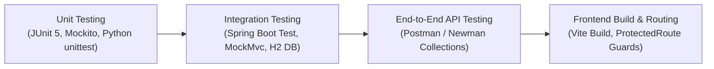

# Software Test Plan (STP)

**Project:** Enterprise Retail Management, Inventory Control & AI-Powered Business Intelligence System  
**Evaluation Scope:** B.Tech Major Project Quality Assurance & Enterprise Readiness  
**Test Frameworks:** JUnit 5, Mockito, Spring Boot Test, MockMvc, Python unittest, Vite Build

---

## 1. Test Strategy & Objectives

The test strategy validates:
1. **Core Business Logic Integrity:** Double-entry ledger consistency, atomic stock deductions, and multi-warehouse transfers.
2. **Security & RBAC Enforcement:** Authentication barriers, unauthorized role rejection, and password encryption.
3. **AI Mathematical Correctness:** Train/test chronological split (preventing lookahead bias), MAE/RMSE calculation, and safety-stock formula consistency.
4. **Resiliency:** Deterministic fallback activation when external services are unreachable.
5. **Frontend Asset Integrity:** Production bundle compilation and route protection.

---

## 2. Test Classification Matrix

---

## 3. Systematic Test Cases Matrix

| TC ID | Module | Test Scenario | Input Data | Expected Result |
| :--- | :--- | :--- | :--- | :--- |
| **TC-01** | Auth | Login with valid Admin credentials | `username: "admin"`, `password: "admin123"` | HTTP 200, JWT token returned with `ROLE_ADMIN` |
| **TC-02** | Auth | Login with invalid password | `username: "admin"`, `password: "wrongpass"` | HTTP 401 Unauthorized, zero credentials leakage |
| **TC-03** | Auth | Change password with mismatched confirmation | `newPassword: "pass"`, `confirm: "diff"` | Rejected with validation error |
| **TC-04** | Catalog | Create product with unique SKU | SKU: `AUDIO-BT-001`, Price: 7999.00 | HTTP 201 Created, product stored in database |
| **TC-05** | Catalog | Create duplicate SKU | SKU: `AUDIO-BT-001` | HTTP 400 Bad Request, duplicate SKU prevented |
| **TC-06** | Catalog | Soft-delete product | `DELETE /api/v1/products/1` | Product `active` flag set to `false`, history intact |
| **TC-07** | Inventory | Stock adjustment (IN) | `productId: 1`, `qty: 50`, `type: ADJUSTMENT_IN` | Stock balance increments; `StockMovement` logged |
| **TC-08** | Inventory | Prevent direct unlogged edits | Manual update without movement | Rejected by architecture design |
| **TC-09** | POS | Complete sales transaction | Customer details, items, payment method: `CASH` | Stock decremented atomically, invoice generated |
| **TC-10** | POS | Prevent overselling on zero stock | Requested qty: 9999, Available: 5 | `InsufficientStockException`, transaction rolled back |
| **TC-11** | Transfers | Inter-warehouse stock transfer | `originId: 1`, `destId: 2`, `qty: 10` | 2-phase state machine (`DISPATCHED` → `RECEIVED`) |
| **TC-12** | Procure | Purchase order workflow | `DRAFT` → `APPROVED` → `RECEIVED` | Stock increments only when receipt is confirmed |
| **TC-13** | AI | Time-series demand forecasting | 30 days history, horizon: 7 days | Projections generated with positive MAE/RMSE |
| **TC-14** | AI | Chronological train/test split | Time-ordered sales series | Split strictly chronological, no data leakage |
| **TC-15** | AI | Safety-stock calculation | $d=5$, $L=3$, $SS=10$ | $ROP = 5 \times 3 + 10 = 25$, formula transparent |
| **TC-16** | AI | Fallback when Python microservice offline | Python service shutdown | Backend uses Java statistical fallback seamlessly |
| **TC-17** | RBAC | Cashier attempting to create user | `POST /api/v1/auth/register` with Cashier JWT | HTTP 403 Forbidden |
| **TC-18** | Reports | Executive dashboard KPIs | `GET /api/v1/reports/dashboard-summary` | Returns active products, low stock, revenue |
| **TC-19** | Audit | Security event recording | Execute stock adjustment or login | Audit row created in `audit_logs` table |
| **TC-20** | Frontend | Production bundle compilation | `npm run build` | Zero syntax/import errors, optimized chunks |
