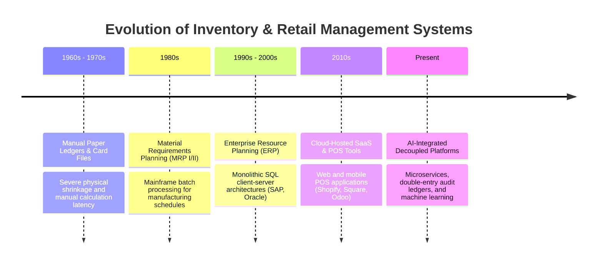

# Chapter 2: Literature Survey & Comparative Analysis

---

## 2.1 Evolution of Retail & Inventory Management Systems

The trajectory of retail inventory management systems spans five key technological eras:

1. **Manual & Tabular Ledger Systems (Pre-1980):** Inventory was recorded in physical books. Audits occurred annually, leading to severe inventory drift, shrinkage, and stockout frequency.
2. **Material Requirements Planning (MRP I & II) (1980s):** Introduced computer-assisted bill-of-materials and reorder scheduling, but restricted to large mainframe installations in manufacturing.
3. **Monolithic Enterprise Resource Planning (ERP) (1990s–2000s):** Unified accounting, inventory, and procurement. While structurally sound, platforms like SAP R/3 required multi-million dollar capital expenditure, lengthy multi-year rollouts, and specialized consulting.
4. **Cloud SaaS & Lightweight POS Apps (2010s):** Emerged to serve SMEs. However, many contemporary cloud POS tools treat inventory as a mutable integer field in a database, lacking double-entry audit ledgers, multi-warehouse transfer protocols, or scientific replenishment math.
5. **Modern AI-Augmented Microservice Suites (Present):** Combines distributed services, reactive single-page client applications, persistent ACID storage, and machine learning models for demand velocity and safety-stock calculation.

---

## 2.2 Survey of Existing Solutions

### 2.2.1 SAP S/4HANA Retail & Oracle Retail ERP
- **Strengths:** Robust double-entry accounting integration, industrial-grade concurrency handling, extensive multi-enterprise supply chain modeling.
- **Deficiencies:** Exorbitant licensing costs, massive hardware resource requirements, complex user interfaces requiring months of staff training, and rigid customization barriers.

### 2.2.2 Odoo ERP (Open Source Community / Enterprise)
- **Strengths:** Modular Python/PostgreSQL framework with good web UI and extensible apps.
- **Deficiencies:** Complex ORM abstraction often incurs database locking overhead during high-volume sales bursts. Community edition locks critical enterprise multi-warehouse and reporting features behind commercial licenses.

### 2.2.3 Commercial SaaS POS (Square Retail, Shopify POS, Lightspeed)
- **Strengths:** Sleek touch-screen interfaces, rapid onboarding, turnkey payment terminal integration.
- **Deficiencies:** Limited offline resiliency, opaque closed-source subscription models, simplistic linear reorder triggers that ignore lead-time variances, and vulnerability to network latency.

---

## 2.3 Limitations of Contemporary Systems & Research Gaps

A comprehensive review of academic literature and enterprise implementations reveals several critical research and engineering gaps:

1. **Gap 1: Absence of Double-Entry Stock Movement Auditing in SME Systems:**  
   Most modern web applications execute direct SQL updates (`UPDATE inventory SET qty = qty - ? WHERE id = ?`). If a network timeout or application crash occurs during checkout, stock records desynchronize from sales ledgers without an audit trail.
2. **Gap 2: "Black Box" AI Forecasting without Formula Transparency:**  
   When modern systems incorporate machine learning, they often output opaque reorder numbers without exposing parameter decomposition ($d$, $L$, $\sigma_d$, $SS$). Inventory managers frequently override these suggestions because they lack insight into how the values were derived.
3. **Gap 3: Fragile Microservice Coupling:**  
   Many architectures tightly bind the core checkout path to external predictive microservices or cloud AI APIs. An outage or rate-limit on the AI service degrades the core POS and inventory operations.
4. **Gap 4: Inadequate Concurrency Protection against Overselling:**  
   Web applications frequently execute stock checks in one request and stock decrements in another without database-level locking, resulting in race conditions and overselling during peak traffic.

---

## 2.4 Proposed Contributions of this Project

This project resolves these shortcomings through specific architectural innovations:
- **Immutable Double-Entry Ledger:** Every stock modification generates an atomic `StockMovement` row recording pre- and post-balances, reference IDs, and user IDs.
- **Operations Research Formula Transparency:** The replenishment engine displays full formula decomposition ($SS = Z \times \sigma_d \times \sqrt{L}$ and $ROP = d \times L + SS$) directly on the user interface.
- **Graceful Circuit-Breaker Fallback:** The backend incorporates internal statistical models that activate automatically if the Python microservice is unreachable, ensuring zero operational downtime.
- **ACID Concurrency Controls:** Transactions enforce optimistic locking via JPA `@Version` and row-level database checks to eliminate race conditions.

---

## 2.5 Comparative Analysis Table

| Feature / Architectural Dimension | Traditional SME Billing Apps | Odoo Community | SAP S/4HANA Retail | **Proposed Enterprise System** |
| :--- | :---: | :---: | :---: | :---: |
| **Backend Technology Stack** | PHP / Node.js | Python / PostgreSQL | Proprietary ABAP / SAP HANA | **Java 21 / Spring Boot 3.3.4** |
| **Client Interface** | Server-rendered HTML | Web Templates / OWL | Desktop GUI / Fiori | **React 18 + Vite (Responsive SPA)** |
| **Double-Entry Stock Ledger** | ❌ (Direct updates) | Partial | ✅ Full double-entry | **✅ Full double-entry audit ledger** |
| **Multi-Warehouse Transfers** | ❌ Single store | Basic | ✅ Industrial multi-site | **✅ 2-Phase atomic state machine** |
| **Concurrency Lock (Anti-Oversell)**| ❌ None | Database locks | Pessimistic / Enqueue | **✅ Optimistic Locking (`@Version`)** |
| **Role-Based Access Control (RBAC)**| Basic (Admin/User) | Group-based | Complex Authorizations | **✅ 4 Explicit Roles with JWT Guards** |
| **AI Demand Forecasting** | ❌ None | ❌ Commercial add-on | Proprietary SAP IBP | **✅ Time-Series Microservice (FastAPI)** |
| **Formula Transparency UI** | ❌ N/A | ❌ N/A | Low | **✅ High (Exact parameters visible)** |
| **Autonomous Offline Fallback** | ❌ N/A | ❌ N/A | ❌ N/A | **✅ Automatic Statistical Fallback** |
| **Licensing / Deployment Cost** | Low / Subscription | Open-source core | Extremely High ($100k+) | **Open-Source / Zero License Fee** |
