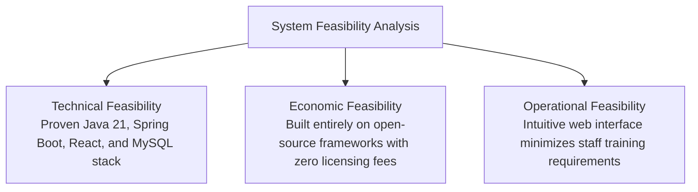

# Chapter 3: Software Requirements Specification (SRS)

---

## 3.1 Functional Requirements

The system requirements are organized across eight core functional modules:

### Module A: Authentication, Authorization & User Management
- **FR-A1 (Authentication):** Users authenticate via username and password. On successful authentication, the server returns an HMAC-SHA256 signed JWT token.
- **FR-A2 (Role-Based Access Control):** Enforce four organizational roles (`ROLE_ADMIN`, `ROLE_MANAGER`, `ROLE_INVENTORY_STAFF`, `ROLE_CASHIER`) across all REST endpoints and frontend routes.
- **FR-A3 (Account Provisioning):** Only Administrators can register new accounts and assign roles.
- **FR-A4 (Password Management):** Authenticated users can modify their passwords via BCrypt verification.
- **FR-A5 (Account Lifecycle):** Support active/inactive toggling without deleting historical audit records.

### Module B: Master Catalog & Category Management
- **FR-B1 (Product Master):** Support product creation with unique SKU, optional barcode, cost price, selling price, tax rate, reorder level, and target stock.
- **FR-B2 (Category Hierarchy):** Organize products into hierarchical categories with unique category codes.
- **FR-B3 (Soft Deletion):** Products with existing transactional records are soft-deactivated to preserve ledger integrity.

### Module C: Multi-Warehouse Inventory Management
- **FR-C1 (Stock Tracking):** Maintain physical on-hand and reserved stock balances per product per warehouse.
- **FR-C2 (Double-Entry Ledger):** Record every stock change as a `StockMovement` entry with balance before/after and user ID.
- **FR-C3 (Stock Adjustments):** Support cycle-count adjustments (`ADJUSTMENT_IN`, `ADJUSTMENT_OUT`) with mandatory operator justification.

### Module D: Procurement & Purchase Order Lifecycle
- **FR-D1 (Supplier Directory):** Manage vendor records with tax IDs, lead times, and payment terms.
- **FR-D2 (State Machine):** Enforce purchase order state transitions (`DRAFT` → `APPROVED` → `RECEIVED`).
- **FR-D3 (Stock Increment on Receipt):** Stock balances increase only when goods are physically received and inspected.

### Module E: Point of Sale (POS) Billing & Invoicing
- **FR-E1 (Counter Billing):** Enable barcode search, item addition, tax computation, and discount application.
- **FR-E2 (Atomic Deduction):** Decrement inventory balances atomically during checkout within a database transaction.
- **FR-E3 (Invoice Generation):** Generate sequential invoice numbers with printable thermal/PDF receipts.
- **FR-E4 (Sales Returns):** Support customer returns with optional inventory restock.

### Module F: Multi-Facility Stock Transfers
- **FR-F1 (Transfer Request):** Create transfer manifests between origin and destination warehouses.
- **FR-F2 (Two-Phase Execution):** Decrement origin stock on `DISPATCHED` and increment destination stock on `RECEIVED`.

### Module G: Executive Reporting & Business Intelligence
- **FR-G1 (Dashboard):** Display active SKU count, total units, low-stock alerts, today's sales, and month-to-date revenue.
- **FR-G2 (Inventory Valuation):** Calculate valuation based on cost basis vs. projected retail selling value.
- **FR-G3 (Top Sellers):** Rank products by sales volume and revenue generation.

### Module H: AI Demand Forecasting & Natural Language Assistant
- **FR-H1 (Time-Series Forecasting):** Generate multi-day demand forecasts using linear regression and moving averages.
- **FR-H2 (Safety-Stock Recommendations):** Calculate reorder points using operations research formulas ($SS = Z \times \sigma_d \times \sqrt{L}$).
- **FR-H3 (Formula Transparency):** Expose exact mathematical parameters ($d$, $L$, $SS$, $ROP$) in the UI.
- **FR-H4 (Grounded Assistant):** Answer retail queries using live database records.
- **FR-H5 (Resilient Fallback):** Automatically switch to internal statistical algorithms if the Python microservice is offline.

---

## 3.2 Non-Functional Requirements (NFRs)

| NFR Category | Metric / Specification | Verification Method |
| :--- | :--- | :--- |
| **Performance** | API response latency < 200 ms for 95% of standard read/write requests | Apache Bench / Postman Runner |
| **Concurrency** | Prevent overselling during simultaneous checkouts | JPA `@Version` Optimistic Locking |
| **Security** | Passwords hashed with BCrypt (cost factor 10); stateless JWT auth | Security audit & Penetration testing |
| **Data Integrity** | ACID compliance with InnoDB foreign key constraints; 3NF schema | Database schema validation |
| **Availability** | Core inventory & POS remain operational during AI microservice downtime | Fallback unit tests |
| **Usability** | Fully responsive UI across desktop (1920x1080), tablet, and mobile | Chrome DevTools device simulation |

---

## 3.3 Hardware, Software, and Network Prerequisites

### 3.3.1 Hardware Requirements
- **Processor:** 64-bit Intel Core i5 / AMD Ryzen 5 or Apple Silicon (M1/M2/M3)
- **RAM:** Minimum 8 GB (16 GB recommended for concurrent Docker execution)
- **Disk Storage:** Minimum 10 GB free space for database, Docker images, and logs

### 3.3.2 Software Requirements
- **Operating System:** macOS (Sonoma/Sequoia), Linux (Ubuntu 22.04 LTS), or Windows 11 with WSL2
- **Java Development Kit:** Oracle JDK or Eclipse Temurin JDK 21 (LTS)
- **Build Tool:** Apache Maven 3.9+
- **Node.js Runtime:** Node.js v20.x or v22.x LTS with npm
- **Python Runtime:** Python 3.11+
- **Relational Database:** MySQL 8.0.x (or built-in H2 MySQL compatibility profile)
- **Containerization:** Docker Engine 24+ and Docker Compose v2+

---

## 3.4 Feasibility Analysis

1. **Technical Feasibility:** The architecture utilizes mature, industry-standard technologies: Java 21, Spring Boot 3.3.4, React 18, and MySQL 8.0. The team verified build and runtime compatibility across macOS and Linux.
2. **Economic Feasibility:** The system is built entirely on open-source technologies, eliminating commercial licensing costs (unlike SAP or proprietary SaaS POS platforms). Deployment uses commodity cloud VPS hosting or local hardware.
3. **Operational Feasibility:** The responsive React UI provides clear role separation, modal workflows, and automated calculations, reducing staff training requirements.
