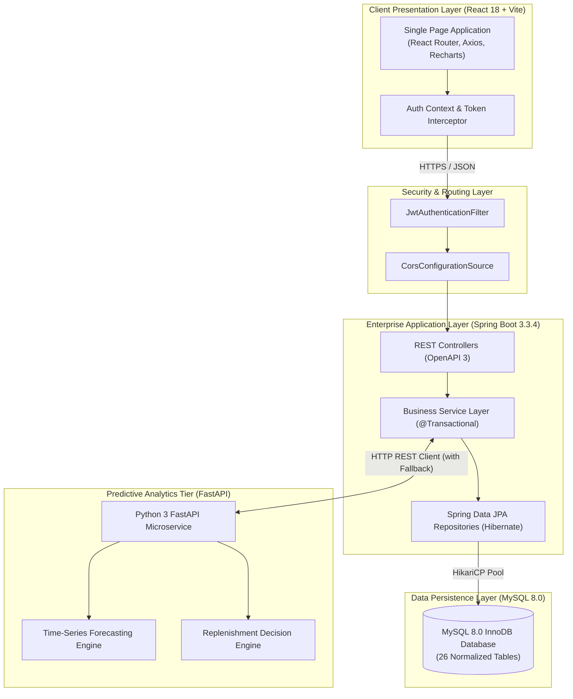
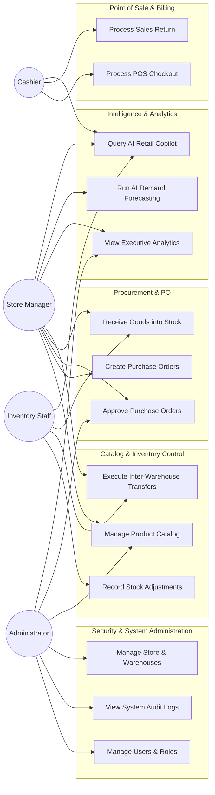
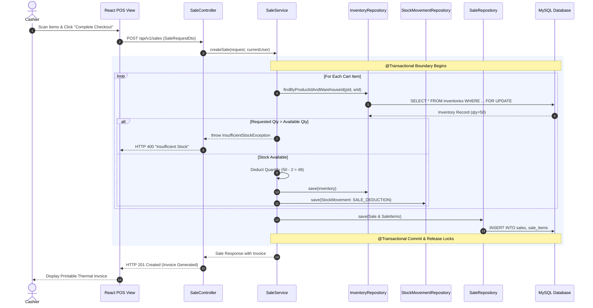
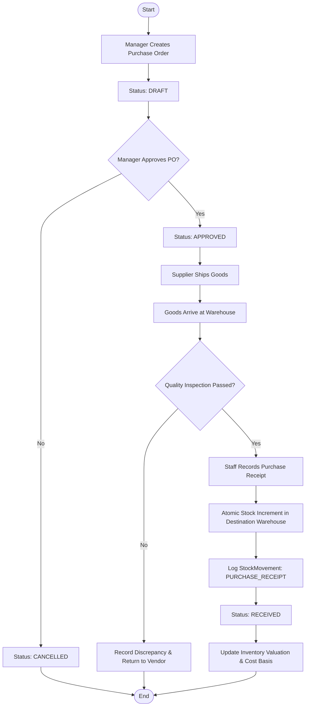
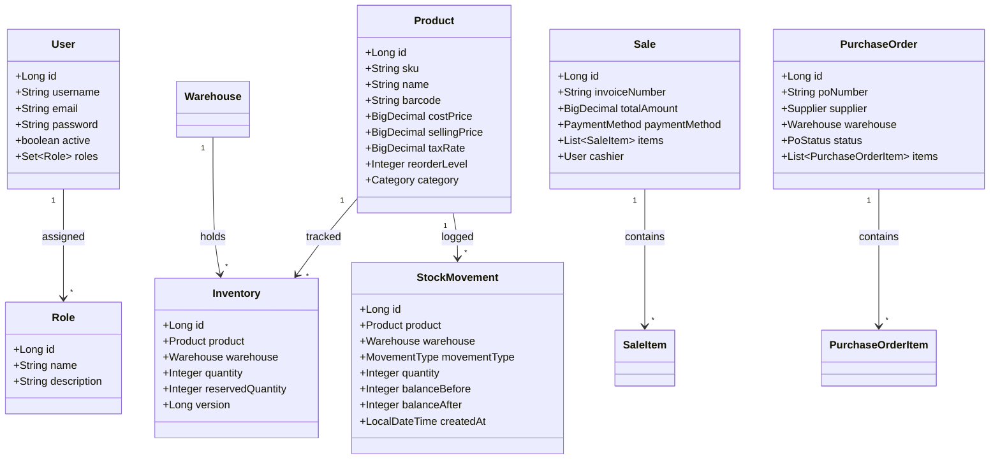

# Chapter 4: System Design & Architecture

---

## 4.1 High-Level Multi-Tier System Architecture

The system follows an enterprise tiered microservice-hybrid architecture designed for horizontal scalability, clear separation of concerns, and fault tolerance:



---

## 4.2 Use Case Modeling

The system defines four organizational actors interacting with specific functional boundaries:



---

## 4.3 Sequence Diagrams

### 4.3.1 POS Sale Checkout & Atomic Stock Deduction

This diagram illustrates the atomic transaction boundary during POS checkout, preventing overselling race conditions:



---

### 4.3.2 Inter-Warehouse Stock Transfer Sequence

```mermaid
sequenceDiagram
    autonumber
    actor OriginStaff as Origin Staff
    actor DestStaff as Destination Staff
    participant UI as Transfer View
    participant API as StockTransferController
    participant Service as StockTransferService
    participant DB as MySQL Database

    OriginStaff->>UI: Submit Transfer Request (Origin: WH-1, Dest: WH-2, Qty: 20)
    UI->>API: POST /api/v1/transfers
    API->>Service: createTransfer()
    Service->>DB: Verify & Reserve Stock; Save Transfer (STATUS = REQUESTED)
    DB-->>UI: Transfer Created

    OriginStaff->>UI: Click "Dispatch Stock"
    UI->>API: PATCH /api/v1/transfers/{id}/dispatch
    API->>Service: dispatchTransfer()
    Service->>DB: Decrement Origin Stock; Log StockMovement (TRANSFER_OUT); Set STATUS = DISPATCHED
    DB-->>UI: Goods in Transit

    DestStaff->>UI: Click "Receive Stock"
    UI->>API: PATCH /api/v1/transfers/{id}/receive
    API->>Service: receiveTransfer()
    Service->>DB: Increment Destination Stock; Log StockMovement (TRANSFER_IN); Set STATUS = RECEIVED
    DB-->>UI: Transfer Complete
```

---

## 4.4 Activity Diagram: Procurement & Receiving Lifecycle



---

## 4.5 Class Diagram: Domain Model & Service Contracts


