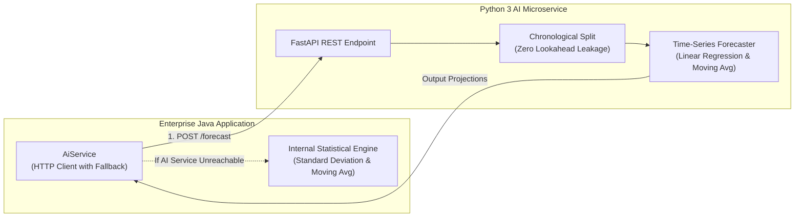

# Chapter 6: AI-Powered Demand Forecasting & Replenishment Intelligence

---

## 6.1 Predictive Analytics Architecture

The system implements a hybrid architecture combining a dedicated Python machine learning microservice with an autonomous statistical fallback inside the Java service layer:

---

## 6.2 Time-Series Demand Forecasting Mathematical Formulation

The forecasting engine analyzes historical daily sales velocity to predict future stock depletion over a multi-day horizon ($H$).

### 6.2.1 Ordinary Least Squares (OLS) Linear Trend Model
For products exhibiting directional trends, the system fits a linear model over time $t \in \{1, 2, \dots, N\}$:

$$\hat{y}_t = \beta_0 + \beta_1 t$$

Where the regression coefficients are calculated as:

$$\beta_1 = \frac{\sum_{i=1}^N (t_i - \bar{t})(y_i - \bar{y})}{\sum_{i=1}^N (t_i - \bar{t})^2}, \quad \beta_0 = \bar{y} - \beta_1 \bar{t}$$

### 6.2.2 Simple Moving Average (SMA) Fallback
For noisy or low-variance demand histories, the engine applies an $m$-day moving average:

$$\hat{y}_{t+1} = \frac{1}{m} \sum_{i=0}^{m-1} y_{t-i}$$

---

## 6.3 Chronological Train/Test Split (Preventing Data Leakage)

In time-series forecasting, standard randomized K-fold cross-validation introduces **lookahead bias (data leakage)** by training on future observations to predict past demand.

To ensure realistic evaluation, the engine enforces a strict **chronological split**:
- **Training Set:** First 80% of historical days: $\{y_1, y_2, \dots, y_{\lfloor 0.8N \rfloor}\}$
- **Testing Set:** Most recent 20% of historical days: $\{y_{\lfloor 0.8N \rfloor + 1}, \dots, y_N\}$

Models are evaluated using standard metrics:
- **Mean Absolute Error (MAE):**
  $$\text{MAE} = \frac{1}{K} \sum_{k=1}^K |y_k - \hat{y}_k|$$
- **Root Mean Squared Error (RMSE):**
  $$\text{RMSE} = \sqrt{\frac{1}{K} \sum_{k=1}^K (y_k - \hat{y}_k)^2}$$

---

## 6.4 Operations Research Safety-Stock & Reorder Point Formulation

To eliminate subjective guesswork in inventory replenishment, the system applies standard operations research inventory formulas:

### 6.4.1 Average Daily Demand ($d$)
Calculated across the active sales window:

$$d = \frac{1}{N} \sum_{i=1}^N y_i$$

### 6.4.2 Demand Standard Deviation ($\sigma_d$)
Quantifies demand volatility:

$$\sigma_d = \sqrt{\frac{1}{N-1} \sum_{i=1}^N (y_i - d)^2}$$

### 6.4.3 Safety Stock ($SS$)
Buffers against demand spikes and vendor delays. At a standard 95% service level ($Z = 1.65$ standard normal distribution quantile):

$$SS = Z \times \sigma_d \times \sqrt{L}$$

Where $L$ is the supplier lead time in days.

### 6.4.4 Reorder Point ($ROP$)
The inventory threshold that triggers a purchase order:

$$ROP = (d \times L) + SS$$

### 6.4.5 Urgency Classification
- **CRITICAL:** $\text{Available Stock} \le 0.5 \times ROP$
- **MEDIUM:** $0.5 \times ROP < \text{Available Stock} \le ROP$
- **NORMAL:** $\text{Available Stock} > ROP$

---

## 6.5 Grounded NLP Assistant (Database RAG)

The AI assistant provides natural-language business answers grounded in live SQL records:
1. User enters a query (e.g., *"What are our top selling products?"*).
2. The assistant identifies the operational intent (`TOP_SELLERS`, `LOW_STOCK`, `REVENUE_TODAY`, `VALUATION`).
3. The system queries the corresponding JPA repository for authoritative numbers.
4. Structured data is formatted into natural language with supporting evidence cards, eliminating hallucinations.

---

## 6.6 Graceful Circuit-Breaker Fallback

If the external Python FastAPI service experiences network timeout or process crash:
1. `AiService.java` catches the `ResourceAccessException` / `HttpClientErrorException`.
2. The internal statistical engine calculates $d$, $\sigma_d$, $SS$, and $ROP$ directly in Java.
3. The response is flagged with `fallbackUsed = true`.
4. Core retail operations, POS billing, and replenishment planning proceed without interruption.
