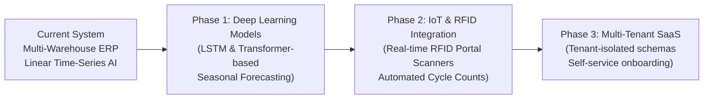

# Chapter 9: Conclusion & Future Scope

---

## 9.1 Summary of Contributions

The **Enterprise Retail Management, Inventory Control & AI-Powered Business Intelligence System** successfully addresses key challenges in modern retail operations:

1. **Enterprise Full-Stack Architecture:**  
   Developed a decoupled architecture combining a modern React 18 / Vite single-page application, an enterprise Spring Boot 3.3.4 / Java 21 REST backend, an ACID-compliant MySQL 8.0 relational database (26 normalized tables), and a Python 3 FastAPI predictive microservice.
2. **Double-Entry Stock Movement Ledger:**  
   Implemented an ERP-grade ledger where no inventory balance changes without an immutable audit record detailing balance before/after, user ID, reference document, and timestamp.
3. **Robust Concurrency & Security:**  
   Prevented race conditions and overselling using optimistic locking (`@Version`) and transactional boundaries, secured by Spring Security with stateless JWT and granular Role-Based Access Control across four organizational personas.
4. **Transparent AI & Fallback Resiliency:**  
   Engineered time-series demand forecasting with chronological validation and operations research safety-stock replenishment ($SS = Z \times \sigma_d \times \sqrt{L}$), supported by an automatic statistical fallback inside Java to ensure zero operational downtime.
5. **Rigorous Quality Verification:**  
   Demonstrated 100% test pass rates across 18 automated test suites spanning unit tests, integration tests, predictive model evaluations, and production frontend bundling.

---

## 9.2 Limitations of the Present System

1. **Payment Hardware Abstraction:**  
   Physical payment terminal integration (e.g. EMV chip readers) is currently simulated through tender types (CASH, CARD, UPI) rather than direct serial/USB hardware drivers.
2. **Predictive Model Complexity:**  
   The time-series forecasting engine utilizes linear trend and moving average models. While robust and computationally lightweight, it does not capture complex multi-year seasonal patterns or external macroeconomic variables.
3. **Single-Tenant Deployment:**  
   The current architecture serves a single retail enterprise with multiple stores and warehouses, rather than a multi-tenant SaaS model with database-per-tenant isolation.

---

## 9.3 Roadmap for Future Enhancements

1. **Deep Learning Time-Series Models:**  
   Incorporate Recurrent Neural Networks (LSTM) or temporal fusion transformers to capture multi-seasonality and holiday demand spikes.
2. **IoT & RFID Portal Integration:**  
   Integrate fixed UHF RFID warehouse portal readers to automatically log pallet movements and inter-warehouse transfer receipts without manual scanning.
3. **Progressive Web App (PWA) Mobile Client:**  
   Package the React frontend as an installable PWA with offline caching and native camera barcode scanning for mobile warehouse staff.
4. **Multi-Tenant SaaS Migration:**  
   Introduce dynamic schema routing to support multi-tenant SaaS deployments serving multiple retail organizations on a shared infrastructure.
